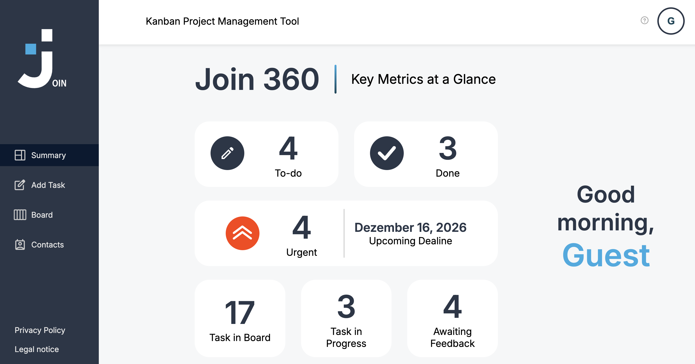
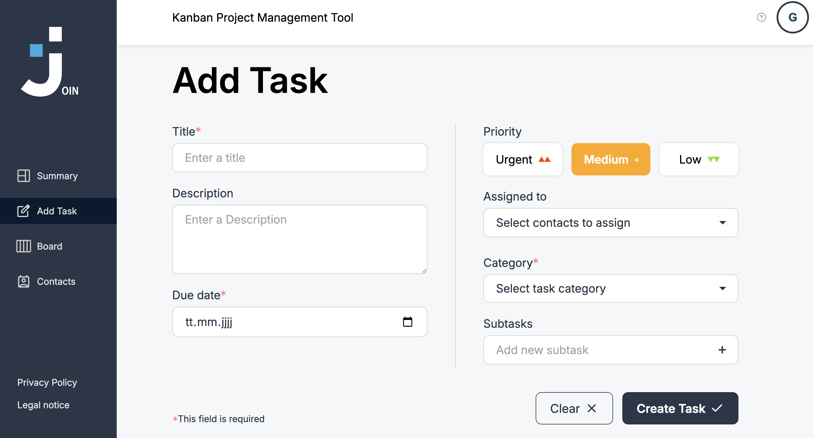

# JOIN – Task Management & Contact Management

JOIN is a web-based task management application that combines a Kanban board with contact management. It helps users organize tasks, track progress, manage deadlines, and keep assigned contacts in one place.

The project was developed as a group project at Developer Akademie.

## Preview

### Summary

### Add Task

## Features

### Task Management

- Create, edit, and delete tasks
- Kanban board with four workflow stages:
  - To do
  - In progress
  - Await feedback
  - Done
- Drag and drop to move tasks
- Alternative **Move to** menu on smaller screens
- Search tasks by title or description
- Assign contacts to tasks
- Set due dates and priorities
- Choose between Technical Task and User Story
- Create and manage subtasks, track subtask progress

### Contact Management

- Alphabetical contact list
- Detail view for individual contacts
- Add, edit, and delete contacts
- Assign contacts to tasks
- Deleted contacts are removed from task assignments

### Summary Dashboard

- Total number of tasks
- Number of tasks per workflow stage
- Open urgent tasks
- Nearest deadline among urgent open tasks
- Greeting based on the time of day

### Authentication & Sessions

- Email and password login
- Guest login
- Session handling with `sessionStorage`
- Access protection for selected pages
- Profile menu and logout

> **Important:** The signup page validates the form, but account creation is not yet connected to the backend. Registration is unfinished.

### Responsive Design

- Responsive navigation and mobile bottom navigation
- Adapted Kanban layout for small screens
- Responsive contact list and detail views
- Mobile-friendly forms and overlays

## Tech Stack

| Technology                 | Purpose                                      |
| -------------------------- | -------------------------------------------- |
| HTML5                      | Application structure                        |
| CSS3                       | Styling and responsive layouts               |
| JavaScript (Vanilla JS)    | Application logic and interactions           |
| Firebase Realtime Database | Data storage via REST API                    |
| Web Crypto API             | Password hashing in the authentication code  |

## Project Structure

Page logic, API communication, database operations, and HTML templates are separated into individual files. The list below is not necessarily complete.

| File                   | Responsibility                                          |
| ---------------------- | ------------------------------------------------------- |
| `script.js`            | Shared functionality, session handling, navigation, profile menu |
| `login.js`             | Login and guest login                                   |
| `authApi.js`           | Authentication-related database requests                |
| `signup.js`            | Signup form validation                                  |
| `firebaseConfig.js`    | Firebase configuration and request helper               |
| `board.js`             | Kanban board interactions                               |
| `tasksApi.js`          | Task database operations                                |
| `tasksDb.js`           | Task data structure and constants                       |
| `tasksTemplates.js`    | Task and board HTML templates                           |
| `addTask.js`           | Creating and editing tasks                              |
| `contacts.js`          | Contact management interactions                         |
| `contactsApi.js`       | Contact database operations                             |
| `contactsDb.js`        | Contact data structure and initial data                 |
| `contactsTemplates.js` | Contact-related HTML templates                          |
| `summary.js`           | Summary dashboard calculations and display              |

## Data Storage

JOIN uses the **Firebase Realtime Database**. The API modules communicate with it through REST requests and handle data for users, tasks, and contacts.

> **Warning:** The privacy policy currently refers to Supabase, while the code uses Firebase Realtime Database. This must be corrected before the project is presented as production-ready.

## Project Status

- [x] Login and guest login
- [x] Session handling
- [x] Kanban board with four workflow stages
- [x] Drag-and-drop task movement
- [x] Alternative task movement for mobile layouts
- [x] Task creation, editing, and deletion
- [x] Task search
- [x] Priorities, categories, and due dates
- [x] Subtask management
- [x] Contact assignment
- [x] Contact creation, editing, and deletion
- [x] Summary dashboard
- [x] Responsive layouts
- [ ] Complete signup and backend account creation
- [ ] Align the privacy policy with the actual database implementation

## Project Context

JOIN is an educational group project. It demonstrates frontend development, REST-based database communication, authentication flows, task management, and responsive user interfaces. It is not intended to replace a full business CRM or enterprise project management platform.

## Acknowledgements

Developed as part of a group project at **Developer Akademie**.